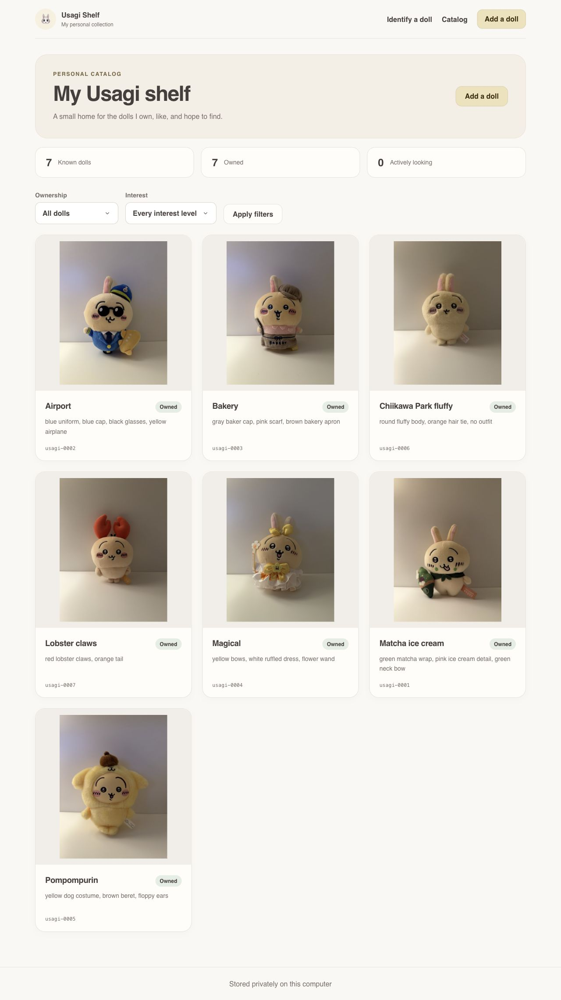
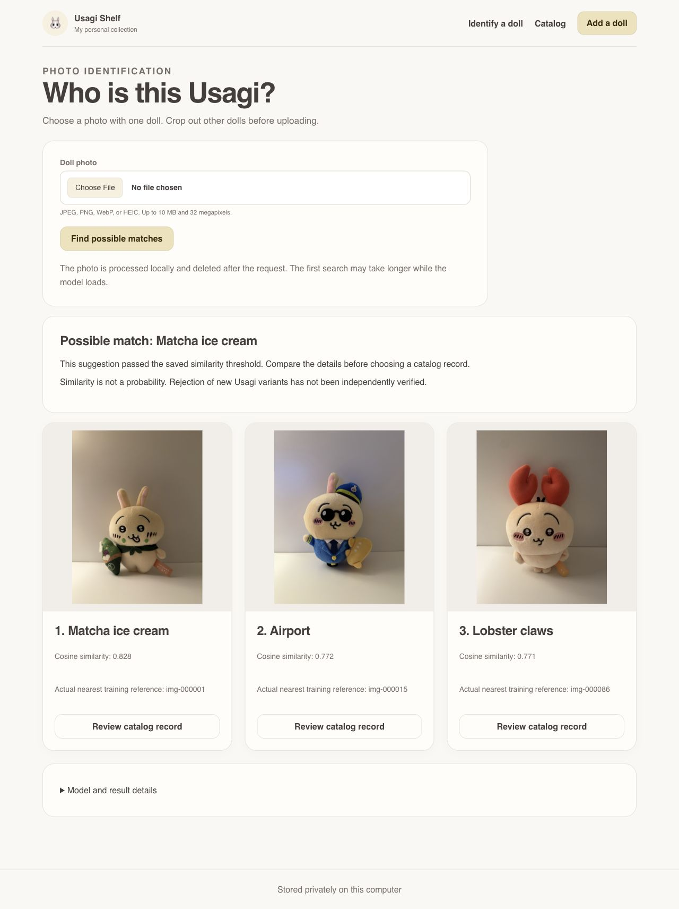

# Usagi Visual Identifier

A computer vision learning project that became **Usagi Shelf**, a local personal
catalog for my Chiikawa Usagi dolls. I can browse my collection, upload a photo,
and compare likely matches with the reference photos that support them.



This is an educational fan project, not an official merchandise catalog or a
public identification service. The current gallery contains seven identities.

A public collection viewer is prepared for GitHub Pages. It uses seven real,
reviewed cover photos from my collection, with search and larger doll details.
Preview it at `http://127.0.0.1:8766` with
`uv run python scripts/preview_public_shelf.py`.
See the [Pages guide](docs/application/public-collection.md) for publication.

## Why I am building this

My master's schedule will not leave room for a formal computer vision course.
I still wanted practical experience collecting data, evaluating models,
training something on my own GPU, and understanding the mistakes.

Then I looked at my Usagi dolls. I am a fan, but very far from a complete
collection. Some collectors have an entire wall. I have a handful that I
especially like and was lucky enough to get. There are many more variants I
do not own and cannot identify by name yet.

That made me wonder whether a photo could tell me which doll I was looking at.
The faces are similar, so the useful clues are often a hat, bow, costume, prop,
or embroidery detail. It felt like a much more interesting way to learn than
another generic image classification dataset.

## What works today

1. Browse, filter, create, and edit personal catalog records in a local web app.
2. Track ownership, interest for dolls I do not own, verification, and notes.
3. Upload one cropped doll photo as JPEG, PNG, WebP, or HEIC.
4. See the three closest identities and their actual nearest training photos.
5. Open a suggested catalog record and review the details myself.

The app returns **Possible match** when the strongest similarity passes the
saved threshold, or **No confident local match** otherwise. A similarity score
is not a probability, and a rejected photo is not proof that the doll is new.
Nothing automatically becomes a catalog edit or training example.



This is a real Session 2 upload: Matcha ice cream scored `0.828` against the
existing `0.821` threshold. It illustrates the interface, not a new accuracy
evaluation. See the [full app showcase](docs/showcase/README.md) for record
editing and a walkthrough of each screen.

## How identification works

```text
One doll photo
    ↓
Validate size and format, correct orientation, remove metadata
    ↓
Frozen DINOv2 Small → normalized 384 dimensional CLS embedding
    ↓
Cosine similarity against the 98 training reference photos
    ↓
Best reference score for each identity → top three identities
    ↓
Saved threshold → possible match or no confident local match
    ↓
Review evidence and open a personal catalog record
```

The browser and JSON API share the same Python service. FastAPI serves the
pages, Jinja renders the interface, and SQLite stores the catalog. The model
loads on the first identification request and is reused. Temporary query files
are deleted when the request finishes, including failures.

Retrieval lets the reference collection grow without requiring a new fixed
classification head. New identities still need suitable reference photos,
gallery rebuilding, and evaluation.

## What the experiments taught me

The data is split by capture session, not randomly across adjacent photos:
98 training photos, 42 validation photos, 42 final known test photos, and 51
unknown validation photos from four other physical products.

| Method | Final known Top 1 | Final known Top 3 |
| --- | --- | --- |
| Frozen DINOv2 nearest image | 41 / 42 | 42 / 42 |
| Partially tuned DINOv2 nearest image | 41 / 42 | 42 / 42 |
| Tuned prototype retrieval | 40 / 42 | 42 / 42 |
| Tuned classifier | 40 / 42 | 42 / 42 |

These are raw ranking results on seven known identities, not accuracy across
all Usagi merchandise. The test session was opened only after model and
threshold choices were frozen.

I trained a linear probe and six partial fine tuning runs on an RTX 3060 with
12 GB VRAM. Conservative augmentation improved validation loss, but fine tuning
did not improve final Top 1 accuracy. The app therefore keeps the simpler frozen
nearest image baseline. The [final test report](docs/experiments/005b-final-known-test.md)
records the comparison and failures.

Unknown rejection is still a limitation. The frozen threshold correctly
accepted 40 of 42 known validation photos but falsely accepted 7 of 51 unknown
validation photos. It accepted only 33 of 42 final known photos, all correctly.
There is no independent unknown final test, so I do not claim reliable rejection
of new Usagi variants. The [unknown validation report](docs/experiments/005-unknown-rejection-validation.md)
explains the tradeoffs.

## Run locally

Use Python 3.12 and [uv](https://docs.astral.sh/uv/):

```bash
git clone https://github.com/emmatyy19/usagi-visual-identifier.git
cd usagi-visual-identifier
uv sync --locked --all-groups
uv run python scripts/run_catalog_app.py
```

Open `http://127.0.0.1:8000/catalog`. In VS Code, use the
`Run Personal Catalog API` debugger configuration for the same server.

**A fresh clone starts with an empty catalog.** My database, original photos,
prepared dataset, embeddings, and model checkpoints are not distributed.
Browsing and manually adding records work without them. Identification needs
the local gallery artifacts and pinned DINOv2 model described in the
[application guide](docs/application/personal-catalog.md). There is no bundled
training gallery or hosted identification service. The separate public shelf
includes only seven reviewed cover photos and their display descriptions.

The committed notebooks contain executed results and reviewed photo renderings
for reading. Rerunning the full experiments requires excluded local data and
artifacts; cloning the repository alone is not enough.

The app supports CPU, Apple Metal, and CUDA through `USAGI_DEVICE`. If the
pinned model is not cached, its loader may download weights from Hugging Face.
Query photos are not uploaded there. Set `HF_HUB_OFFLINE=1` to require cached
model files. Keep this server bound to localhost; it has no login or production
hosting setup.

## Implementation status

| Area | Status |
| --- | --- |
| Data validation, preparation, and session based splits | Implemented |
| Frozen retrieval, aggregation comparison, linear probe, partial fine tuning | Completed experiments |
| Final known evaluation | Completed; not reused for selection |
| Unknown rejection | Validation only; independent unknown test deferred |
| SQLite catalog and browser create, read, and update | Implemented; no deletion |
| Public collection viewer | Implemented; Pages deployment prepared |
| Photo upload, retrieval API, reference evidence | Implemented |
| Saved identification confirmation and correction history | Planned |
| Source links and availability operations | Planned; initial source link schema exists |
| Optional web assisted discovery | Planned |
| Native iPhone and glasses companion | Planned; no device integration yet |

The [implementation status](docs/application/implementation-status.md) separates
working features from remaining work. The [roadmap](docs/roadmap.md) has the full
milestones. Metric learning, deeper tuning, and multi doll detection are optional.

## Explore the project

Start with the [complete project journey notebook](notebooks/project_journey_walkthrough.ipynb)
for the modeling story, then the [app showcase](docs/showcase/README.md) for the UI.

| Topic | Walkthrough or guide |
| --- | --- |
| Embeddings, cosine similarity, aggregation, and errors | [Embedding notebook](notebooks/embedding_baseline_walkthrough.ipynb) |
| Linear head, training curves, logits, and weights | [Linear probe notebook](notebooks/linear_probe_walkthrough.ipynb) |
| GPU training runs and augmentation comparison | [Fine tuning notebook](notebooks/partial_finetune_walkthrough.ipynb) |
| Thresholds and false accepts | [Unknown rejection notebook](notebooks/unknown_rejection_walkthrough.ipynb) |
| Frozen and tuned open set comparison | [Model selection notebook](notebooks/open_set_model_selection_walkthrough.ipynb) |
| Data collection and preparation | [Photo guide](docs/data/photo-capture-guide.md), [preparation guide](docs/data/data-preparation.md) |
| Reproducible GPU workflow | [Training guide](docs/training/partial-finetuning.md) |
| Evidence and decisions | [Experiment records](docs/experiments/README.md) |
| Catalog boundaries and future discovery | [Application design](docs/design/002-personal-catalog-and-discovery.md) |

Reusable code lives in `src/usagi_visual_identifier`, runnable workflows in
`scripts`, and explanations in `notebooks`. The app does not depend on notebooks.
Notebook files are excluded from GitHub language statistics through
`.gitattributes`, but remain available to read and download.

## Development checks

```bash
uv run pre-commit install
uv run ruff format --check .
uv run ruff check .
uv run pyright
uv run pytest --cov=usagi_visual_identifier --cov-fail-under=90
uv build
```

## Privacy and rights

This is an independent educational fan project, not affiliated with Nagano,
Chiikawa, or their official rights holders. Names are informal personal labels,
not an authoritative product catalog.

Reviewed notebook renderings and app screenshots show photographs I took of my
own collection. Original photo files, standalone prepared data, private notes,
credentials, embeddings, and model files remain outside Git.

Source code and written documentation are available under the [MIT License](LICENSE).
Photographs in notebooks, screenshots, or the public shelf are excluded from that grant
and remain © 2026 Emma Tong, all rights reserved. Character and merchandise
rights remain with their respective holders. Dependencies and pretrained models
retain their own licenses. See [media and third party notices](NOTICE.md).
