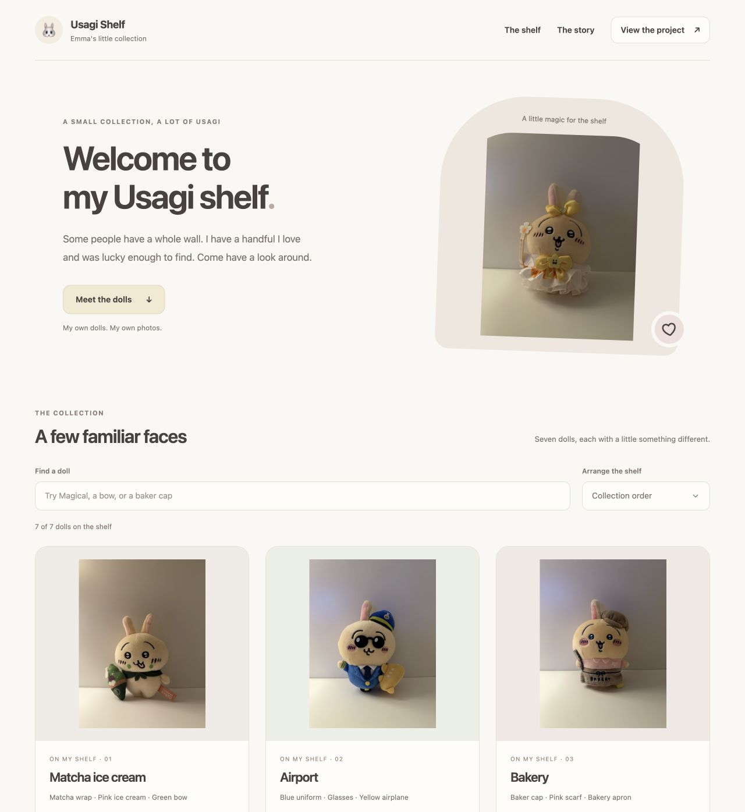

# Public Usagi Shelf

The public shelf is a small static site for browsing my real collection. It
includes seven reviewed, resized Session 1 cover photos and informal display
descriptions. Visitors can search by a name or detail, change the sort order,
and open a doll for a closer look.



This is similar to the separate showcase build in My Caddie, but it uses my
actual doll photos rather than synthetic data. No synthetic collection is needed.

## Public viewer and local application

| Feature | Public collection | Local application |
| --- | --- | --- |
| Browse the seven published dolls | Yes | Yes, with local collection files |
| Search and open larger photos | Yes | Catalog browsing and editing |
| Edit ownership, interest, and notes | No | Yes |
| Upload photos for identification | No | Yes, with local model artifacts |
| Show project code and notebooks | Links to GitHub | Links in documentation |

GitHub Pages hosts HTML, CSS, and JavaScript. The Python model service and SQLite
catalog remain local. This first public version is intentionally a visit to my
collection rather than an upload identification service.

## Preview

Use the `Preview Public Usagi Shelf` debugger configuration, or run:

```bash
uv run python scripts/preview_public_shelf.py
```

Open `http://127.0.0.1:8766`. The preview serves only `site/`. The site itself
needs no Python packages, Node build, database, or model downloads. A plain
Python installation can also run the preview script directly.

## Publication files

`site/collection.json` is an explicit public snapshot. It contains only display
names, local public image paths, brief descriptions, visual cues, and identity
IDs. It is not generated from the private database on deployment. Changes to
private notes or future ownership records do not automatically become public.

The seven images in `site/photos/` are approved publication copies. They are
at most 900 pixels on their longest side, contain no EXIF metadata, and are
not the original photo files or a complete training gallery. Photographs remain
excluded from the MIT grant described in [NOTICE](../../NOTICE.md).

Relative asset URLs support the GitHub project path as well as localhost. The
site does not use analytics, external fonts, browser storage, or a third party API.

## GitHub Pages deployment

The expected address is `https://emmatyy19.github.io/usagi-visual-identifier/`.
It is not live until the first deployment succeeds.

The [Pages workflow](../../.github/workflows/pages.yml) runs on changes to the
site in `main`, or manually on `main`. It checks the public file allowlist and
uploads only `site/`. Deploy permissions are limited to the deployment job.
PR checks validate the collection but do not publish feature branches.

After merging the site PR, select **GitHub Actions** in repository
**Settings → Pages** if it is not already selected. The merge triggers the
workflow; it can also be run from **Actions → Publish Usagi Shelf**. Check the
deployment URL before sharing it.

The [GitHub Pages overview](https://docs.github.com/en/pages/getting-started-with-github-pages/what-is-github-pages)
describes static hosting. Photo identification would need its own deployed
backend or a separately evaluated browser model in a future project slice.

## Updating the shelf

Review each new public description and publication photo explicitly, add them
to `site/`, and update `scripts/check_public_shelf.py` when the collection count
changes. Run the checker and preview before committing. The checker rejects
unexpected site files, unknown record fields, missing covers, and EXIF tags.
