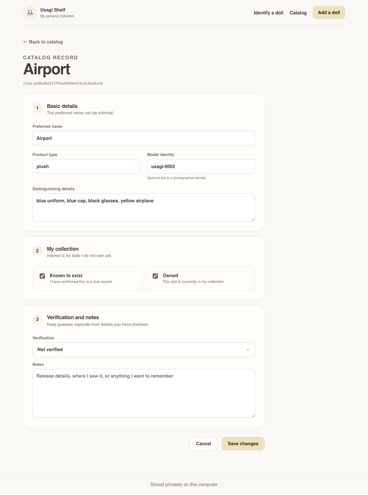

# Usagi Shelf showcase

These are screenshots of the running local application, captured on October 17,
2026. They show my own photographed collection, not a mockup or a hosted demo.
The photos are publication examples, not a distributed training dataset.

## Browse the collection

The shelf shows the seven dolls currently linked to my photographed identities.
Each cover uses the first Session 1 photo. The summary separates known dolls,
owned dolls, and dolls I am actively looking for. Ownership and interest filters
help narrow the collection. Owned dolls do not show an interest badge.

The names are informal labels I chose, not verified official release names.
A new clone will not contain these records or photos.

## Review a record

The record keeps my preferred name, distinguishing details, product type,
and optional model identity together. Ownership does not automatically verify
the product name. The screenshot shows `Not verified` and an empty notes field.
There are no purchase records, personal notes, or local filesystem paths shown.

Interest is hidden while the doll is marked owned. The generated record ID is
an internal identifier, not a credential or a published product identifier.

## Identify one doll

I uploaded a Session 2 Matcha ice cream photo. Frozen DINOv2 nearest image
retrieval returned Matcha ice cream, Airport, and Lobster claws in that order.
The cards show the actual nearest training reference for each identity, rather
than the shelf cover selected for presentation.

The best similarity was approximately `0.828`, above the unchanged `0.820814`
threshold. The wording remains `Possible match`. Similarity is not a probability,
and I still need to compare the details. A lower score would show
`No confident local match`, with alternatives kept visible as suggestions.

The blank upload field after the result is expected: the server does not retain
the query file. Reviewing a catalog record does not save an identification
confirmation or automatically add the image to training data.

## Screenshot provenance

The desktop captures use a 1280 pixel wide browser viewport. They contain no
browser address bar, original photo EXIF metadata, credentials, or purchase notes.
Only rendered app pixels are included. The screenshots were captured from the
implementation merged in PR 17. No catalog records were changed for these views.

The photographs shown are © 2026 Emma Tong, all rights reserved. Character and
merchandise rights remain with their respective holders. See [NOTICE](../../NOTICE.md).
